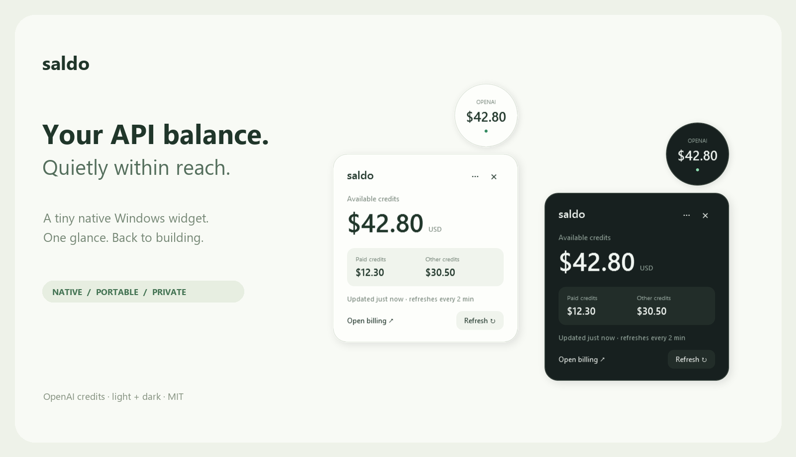
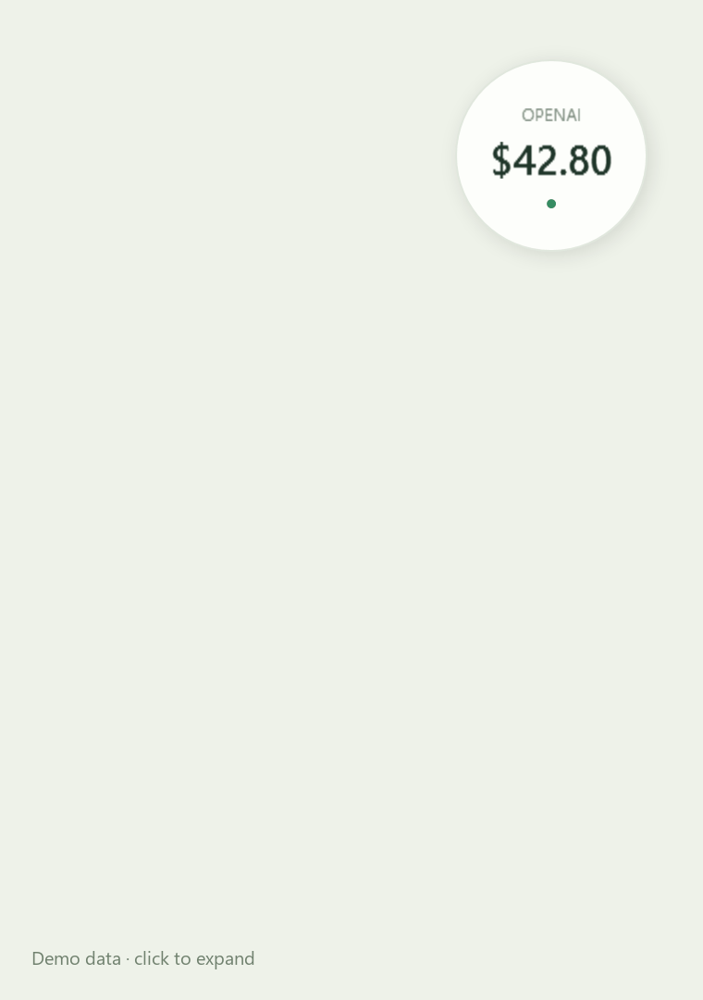

<div align="center">

# Saldo — OpenAI API Balance Widget

**Your API balance. Quietly within reach.**

A tiny, native Windows widget for your OpenAI credit balance. OpenAI API 余额悬浮窗 / 悬浮球。

[简体中文](README.zh-CN.md) · [Connect your account](CONNECT.md) · [Security](SECURITY.md) · [Contribute](CONTRIBUTING.md)



</div>

Saldo puts your API credits in a floating orb. Click once for the breakdown. Then get back to what you were building.

## Small on purpose

- **One portable EXE.** Native WPF, no Electron, browser runtime, Python or NuGet dependencies. Uses the .NET Framework already installed on supported Windows systems.
- **A glance, not a dashboard.** A readable 104-pixel orb by default, an optional pill, light/dark themes and a quiet system tray.
- **The right number.** The main amount is `total_available`. Paid and other credits are shown separately. Paid credits are never substituted for your total.
- **Honest failure states.** A failed request keeps the last known balance, visibly marked stale. It never silently becomes $0.
- **Private by design.** No telemetry, account signup, cloud relay or browser-profile scanning. Sessions are encrypted for the current Windows user and sent only to OpenAI.



## Try it

Requires **Windows 10/11 with .NET Framework 4.8**. Windows only for now.

Download `Saldo.exe` from [Releases](https://github.com/yaoningshun/openai-balance-widget/releases) when a release is available, or build it yourself below. Run it, right-click the orb → **Settings**, and connect your account. Binaries are currently unsigned; release builds include a SHA-256 checksum.

**Important:** OpenAI does not document a public remaining-credit API for inference keys. Saldo uses the **unofficial dashboard billing endpoint** with a manually supplied browser session (`sess-...`). It can expire or change without notice. A regular `sk-...` API key cannot be used here. [Connection guide →](CONNECT.md)

## First connection: get your browser session

The value you need is a **browser billing session beginning with `sess-`**. It is found in a network request, not displayed in the balance table.

1. Open [OpenAI Billing](https://platform.openai.com/settings/organization/billing/overview) in Edge or Chrome. Sign in yourself, select the organization you want to monitor, and open **Credit grants**.
2. Press **F12** or **Ctrl + Shift + I** to open developer tools.
3. Select **Network**. Enter `credit_grants` in its filter box. Keep developer tools open.
4. **Reload the billing page**. Click the request whose name or URL contains `credit_grants`. If it is hidden, switch the network type filter to **All** and reload again.
5. Select **Headers → Request Headers**. Find **Authorization**, for example:

   ```text
   Authorization: Bearer sess-REDACTED
   ```

6. Copy **only the complete `sess-...` value**, without `Authorization:` or `Bearer `. The example above is a placeholder, not a usable session.
7. Right-click the Saldo orb → **Settings**. Paste the value into **Paste browser session**, optionally enter your `org-...` organization ID, and click **Connect**.
8. Saldo checks the session, saves it with Windows account encryption, and displays your total available balance. Click the orb for the paid/other breakdown. Click **×** in the top-right of the detail card to close the card while keeping the orb visible.

Treat the session like a password: paste it only into your local Saldo settings. Never share it in chat, screenshots, issues, commits or browser exports. When it expires, repeat these steps. If `credit_grants` is absent or uses a different authentication mechanism, the current integration may not support your account; do not substitute an unrelated token or disable browser protections. [More connection details](CONNECT.md).

## What the numbers mean

| Label | Meaning |
|---|---|
| Available credits | OpenAI's `total_available`, rounded for display only |
| Paid credits | `total_paid_available`, when returned; otherwise unknown |
| Other credits | Available minus paid; a derived breakdown, not a separately reported grant type |

Grants can expire or have restrictions. The organization and signed-in billing account matter. Saldo does not convert ChatGPT/Codex plan quotas into API dollars, infer balance from a monthly budget, or estimate balance from token prices. Check [OpenAI Billing](https://platform.openai.com/settings/organization/billing/overview) for account details.

## Controls

| Action | Result |
|---|---|
| Click | Expand / collapse |
| × on the detail card | Close details; keep the orb running |
| Drag | Move and remember position |
| Right-click | Refresh, settings, theme, pill/orb, quit |
| F5 / Escape | Refresh / collapse when focused |
| Tray icon | Show details, settings, quit |

Refresh defaults to **120 seconds**. Errors back off to avoid repeated requests. A session expiring requires reconnecting; Saldo never tries to extract browser credentials automatically.

## Build and test

No SDK download or package restore is needed on a Windows machine with the .NET Framework 4.8 compiler and WPF assemblies:

```powershell
./build.ps1 -Test
./dist/Saldo.exe
```

The test executable uses an in-memory HTTP handler. Tests cover total-versus-paid parsing, unknown values, negative balances, formatting, destination restrictions and expired-session errors.

```powershell
# Offline design preview: no credentials, no networking, synthetic balances.
./dist/Saldo.exe --demo
./dist/Saldo.exe --demo --dark --expanded
```

## Publishing this repository

The source tree contains no runtime account data. Settings live in `%LOCALAPPDATA%/Saldo`; the session is stored in `session.dpapi`. Do not put those files, browser exports or personal screenshots in issues or commits.

The project repository is [yaoningshun/openai-balance-widget](https://github.com/yaoningshun/openai-balance-widget). The included GitHub Actions workflow builds and tests on Windows. Pushing a `v*` tag publishes a release binary and checksums. See [RELEASING.md](RELEASING.md) for the release steps.

Want to help? A clear bug report, a thoughtful translation or a small UI improvement is welcome. If Saldo is useful to you, a star helps others find it.

MIT licensed. Independent project; not affiliated with or endorsed by OpenAI. Screenshots and animation use synthetic balances.
