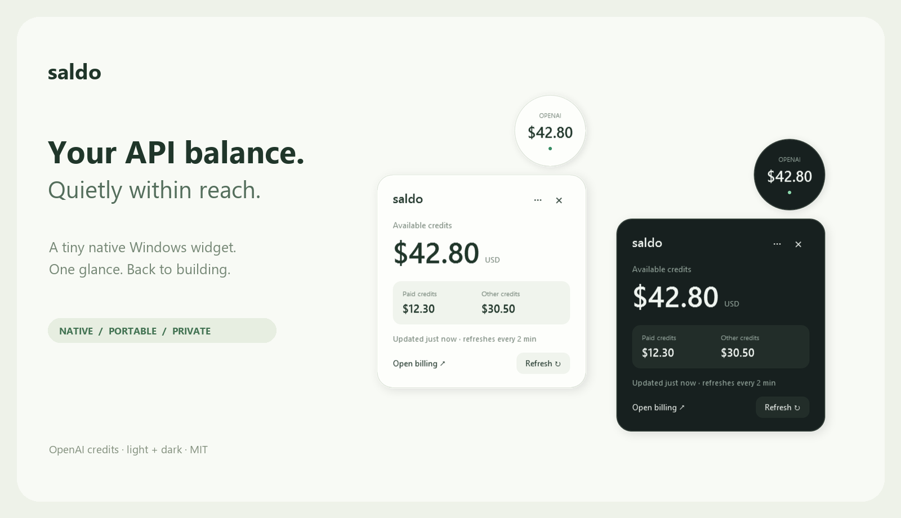

# Saldo — OpenAI API 余额悬浮窗

**API 余额，抬眼可见。**

一个小而克制的 Windows 原生 OpenAI 余额悬浮窗。[English](README.md)



## 做好一件小事

- 一个便携 EXE，无 Python、Electron、WebView 或第三方运行时下载；使用 Windows 上的 .NET Framework 4.8。
- 默认直径 104 像素的圆形悬浮球，大字号余额，点击展开；可切换胶囊和浅色 / 深色，支持拖动、记住位置与托盘。
- 默认显示**总可用余额**，付费部分单列，避免把付费余额误当总余额。
- 查询失败保留上次结果并标记，绝不把网络错误伪装成零余额。
- 不扫描浏览器、不收集遥测、不经过开发者服务器；会话用 Windows 当前账户加密。

## 使用

需要 Windows 10/11 和 .NET Framework 4.8。发布版本后可从 [GitHub Releases](https://github.com/yaoningshun/openai-balance-widget/releases) 下载 `Saldo.exe`；也可从源码构建。右键悬浮球 → Settings 连接账户。

**接入限制请先看：** OpenAI 普通 `sk-...` 推理 Key 不能直接查询充值余额。本项目使用未公开保证稳定性的网页账单接口，需要自己提供 `sess-...` 网页会话。会话可能到期，接口也可能变化。[连接说明](CONNECT.md)

主数字取 `total_available`；付费取 `total_paid_available`；其他额度是两者之差，并不代表所有额度都有相同的模型适用范围。请以相同组织下的官网 Billing 详情为准。

默认每 120 秒刷新，失败后退避重试。单击展开、拖动移动、右键刷新 / 设置 / 切换样式 / 退出；展开后按 Escape 收起。

## 首次连接：详细获取 sess- 会话

需要取得的是 **`sess-...` 开头的网页登录凭证**。它在浏览器的账单请求中，余额表格本身不会显示这个值。

1. 使用 Edge 或 Chrome 打开 [OpenAI Billing](https://platform.openai.com/settings/organization/billing/overview)，自己完成登录，并选择需要监控的组织，进入 **Credit grants** 标签页。
2. 按 **F12**，或 **Ctrl + Shift + I**，打开浏览器开发者工具。
3. 选择 **Network／网络** 标签，在过滤框输入 `credit_grants`。保持开发者工具打开。
4. **刷新账单网页**。在请求列表中点击名称或 URL 包含 `credit_grants` 的请求。如果列表为空，先将网络请求类型切换为 **All／全部**，再刷新一次。
5. 选择 **Headers／标头 → Request Headers／请求标头**，找到 **Authorization**，形式如下：

   ```text
   Authorization: Bearer sess-REDACTED
   ```

6. 只复制**完整的 `sess-...` 部分**，不要复制 `Authorization:` 和 `Bearer `。上述内容只是格式示例，不能用于登录。
7. 右键 Saldo 悬浮球 → **Settings**，将凭证粘贴到 **Paste browser session** 密码框。如果需要指定组织，可填写 `org-...` 组织 ID；随后点击 **Connect**。
8. 连接成功后，球上显示总可用余额。点击球体可查看付费和其他额度；详情右上角的 **×** 只收起详情，悬浮球继续显示。

凭证会用 Windows 当前账户加密保存在本机。**只粘贴到你本机的 Saldo 设置中，不要发给他人，也不要放进截图、GitHub Issue、代码提交或浏览器导出文件。** 会话过期时重复以上步骤重新连接。

如果始终找不到该请求，或官网已改用其他授权方式，当前接入可能不适用于该账户；不要复制不相关的凭证，也不要关闭浏览器安全措施。[更多连接说明](CONNECT.md)

## 构建

```powershell
./build.ps1 -Test
./dist/Saldo.exe
```

无需 NuGet 依赖，使用 Windows 自带目录下的 .NET Framework 编译器。`--demo` 参数使用模拟余额，既不读凭据也不联网。测试使用内存 HTTP 模拟器。

项目仓库：[yaoningshun/openai-balance-widget](https://github.com/yaoningshun/openai-balance-widget)。项目已包含双语 README、产品图、动图、MIT 协议、贡献与安全说明、问题模板和 GitHub 构建 / 发版工作流。推送 `v*` 标签会触发发版。可执行文件当前未签名，构建流程会生成 SHA-256 校验值。

账户运行数据保存在 `%LOCALAPPDATA%/Saldo`，不在代码目录。不要把该目录、真实会话、浏览器导出或含私人余额的截图上传 GitHub。项目独立开发，与 OpenAI 无隶属关系。配图全部使用模拟数据。

MIT 开源。欢迎通过问题报告、翻译和细节打磨帮助它变好。
